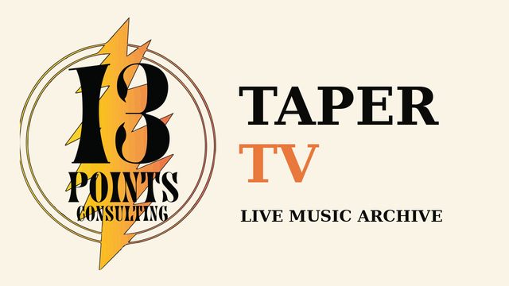

# Taper TV

A Google TV / Android TV app for the Internet Archive's [Live Music Archive](https://archive.org/details/etree):
every band, every show, every taper. It also covers the [Tapers Section](https://archive.org/details/taperssection), where artists without their own Live Music Archive collection live. Remote-in-hand, no phone needed.



## What it does (v1)

- **Artists → year → show → source.** Pick a band, a year, a night, then which tape of that night.
- **Sort sources** by rating, by taper, soundboards first, or most played.
- **Tapers.** Search a taper by name, follow them, and browse everything they've recorded,
  newest first or by band. Every recording links to "More from <taper>".
- **Search** by band, venue, city or date.
- **On This Day** and **Favorites** (bands, tapers, shows), stored on the TV.
- **Background playback**: the show keeps playing when the screen idles.

No account, no backend. The app talks straight to archive.org's public search and metadata APIs.

## Install on the TV

Every push to `main` builds an APK and publishes it as the rolling `latest` release.
Every build is signed with the same key, so new builds install over old ones.

1. Download `taper-tv.apk` from the [latest release](../../releases/latest).
2. Get it onto the TV (the "Send files to TV" app is the easy way from a phone).
3. Open it on the TV and allow installs from that app when asked.

## Build

```
./gradlew assembleDebug
```

Kotlin, Jetpack Compose, Media3. Networking is `HttpURLConnection` + `org.json` on purpose: no extra dependencies.

## Where things live

| Path | What |
| --- | --- |
| `app/src/main/java/.../data/Archive.kt` | archive.org client and data models |
| `app/src/main/java/.../data/Favorites.kt` | on-device favorites |
| `app/src/main/java/.../playback/` | Media3 service and the UI's handle on it |
| `app/src/main/java/.../ui/` | screens, navigation, shared components |
| `brand/` | 13pts retro logo source used for the icon and banner |
| `docs/tighten-up.md` | shortcuts taken to ship v1, to do properly later |

— Vega
